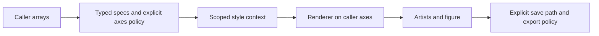

# Plot Foundation

[English](README.md) · [简体中文](README.zh-CN.md) · [Computed gallery](docs/assets/showcase/gallery.html) · [Public API](docs/public-api.md)

Typed plot specifications, scoped style profiles and Matplotlib renderers for scientific arrays. Draw on caller-owned axes, then explicitly choose how and where to save. **Version 0.1.13 · Python 3.10+ · NumPy + Matplotlib.**


These images are generated by the public renderers from independent analytic functions. [Runnable source](examples/synthetic_rendering.py) · [Source hashes, versions and checks](docs/assets/showcase/manifest.json). They are software demonstrations, not experimental or simulation results.

## From arrays to artists

| Data/view | Public building blocks |
|---|---|
| Lines and intervals | `LineSeries`, `RibbonSeries`, `ColorMappedLineSeries`, `LinePlotSpec` |
| Scalar grids and contours | `HeatmapPlotSpec`, `HeatmapStyle`, `render_heatmap` |
| Multi-layer surfaces | `SurfaceLayer`, `MultiSurfacePlotSpec`, `render_multi_surface_3d` |
| Vectors and directors | `VectorFieldPlotSpec`, `render_vector_field` |
| Polarization | `render_polarization_ellipses`, Poincare scatter/trajectory renderers |
| Presentation and export | `profile_context`, `SaveSpec`, `save_figure` |



Renderers can create a figure when axes are omitted, or reuse caller-owned axes. They never save, close figures or create directories. Saving is separate and requires an existing parent directory. Importing the package does not change global Matplotlib style. Domain semantics, DataFrames, readers, manifests and consumer workflows remain outside the library.

## Install and run

Use Python 3.10+ and Git for the pinned public-source install below. A verified local `plot_foundation-0.1.13-py3-none-any.whl` is also suitable; no package-index release is assumed.

```bash
python -m venv .venv
# Activate .venv for your shell, then:
python -m pip install "plot-foundation @ git+https://github.com/Patr1ck2005/plot-foundation.git@c3d3cc23b2bb4da7ade7e5edf553d4a36d19db7f"
python -m pip check
python examples/synthetic_rendering.py --out docs/assets/showcase
```

Run the last command from this repository. It writes five PNG/SVG figure pairs, an offline HTML gallery and a provenance manifest. It verifies x-first orientation, NaN masks, caller-axes reuse, surface layer count, normalized Stokes vectors and restoration of global style.

## A complete rendering example

```python
from pathlib import Path
from plot_foundation import (
    AxesSpec, LinePlotSpec, LineSeries, SeriesStyle,
    SaveSpec, profile_context, render_line_plot, save_figure,
)

Path("output").mkdir(exist_ok=True)  # Caller owns directories.
spec = LinePlotSpec(
    series=(LineSeries([0, 1, 2], [0, 1, 0],
                       style=SeriesStyle(color="blue")),),
    axes=AxesSpec(xlabel="x", ylabel="Amplitude"),
)
with profile_context("publication_minimal"):
    result = render_line_plot(spec)
    save_figure(result.figure, "output/line.svg",
                SaveSpec(dpi=300, bbox_inches=None, transparent=True))
```

The caller also owns closing the figure. Use explicit geometry, labels and save policy for final placement rather than assuming a profile resolves all physical choices.

## Grid and surface contracts


Grid specs use `values.shape == (len(x), len(y))`. The renderer adapts this x-first orientation for display. Transpose a y-first consumer payload explicitly at its adapter boundary. The example's 61 × 35 grid is non-square so accidental orientation changes are detectable.

A surface is a view of a **2D scalar grid**, not evidence of dense 3D sampling. Multi-surface layers keep height, color, alpha and RGBA separate. NaNs preserve missing cells without altering the physical height scale or producing hidden mesh files.

| Independent surface channels | Polarization views |
|---|---|
|  |  |

[Line/scatter/ribbon/color-line family](docs/assets/showcase/line-family.png) · [Complete offline gallery](docs/assets/showcase/gallery.html).

## Style policy and documentation by task

| Task | Authoritative entry |
|---|---|
| Research figure delivery and complete article packages | [Style and A4 delivery policy](docs/style-policy.md#a4-paper-delivery) |
| Apply profiles, fixed-size export and consumer contracts | [Style implementation and delivery guidance](docs/style-policy.md) |
| Classify data before choosing a view | [Data Space and Visualization Views](https://github.com/Patr1ck2005/plot-workflows/blob/main/docs/data-space-and-visualization.md) |
| Use rendering interfaces | [Public API](docs/public-api.md), [line contract](docs/line-rendering-contract.md) |
| Develop or maintain the package | [Architecture](docs/architecture.md), [Agent rules](AGENTS.md), [changelog](CHANGELOG.md) |

Profiles separate presentation: `diagnostic` enables explanatory labels/legends and uses a 150 DPI save preset; `publication_minimal` uses minimal presentation and a transparent tight-cropped 300 DPI preset; `preview` is minimal at 150 DPI; `paper` aliases `publication_minimal`. `profile_context()` scopes style, while explicit `SaveSpec` controls actual export. Legacy defaults and example geometry are distinct from the canonical figure-delivery policy.

Aspect, limits, normalization and colormaps remain caller choices. The gallery explicitly uses fixed-canvas 180 DPI documentation previews and records exported dimensions. Scientific interpretation and project-specific conventions remain in the consumer project.

For development, install `.[dev]` in an isolated environment and run `python -m pytest -q`. Stable consumers install wheels and do not inject sibling source paths. [Original concept artwork](docs/assets/portfolio/scientific-tools-research-v2.png) and [artwork provenance](docs/assets/portfolio/manifest.json) remain auxiliary illustrations. MIT licensed.
