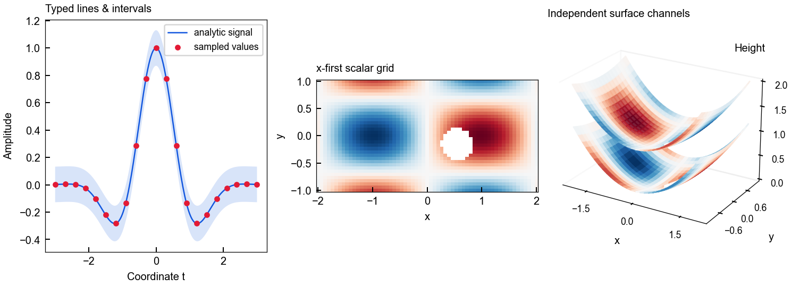
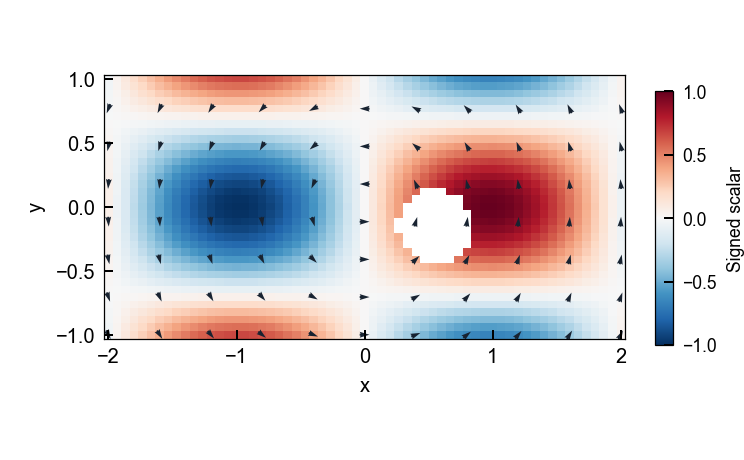
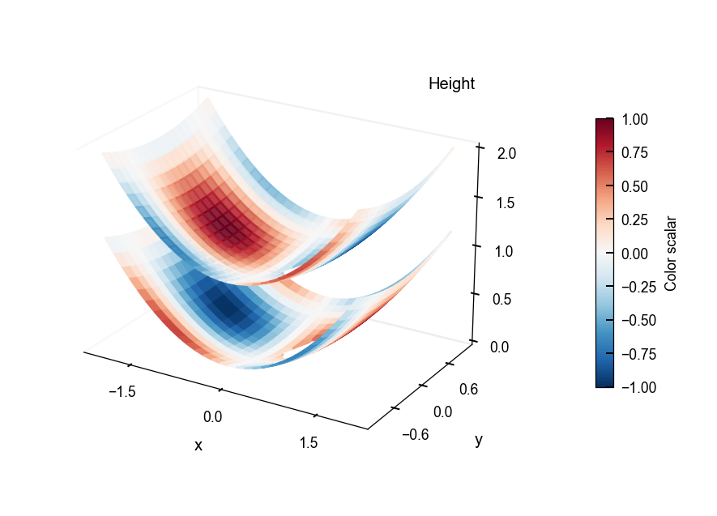
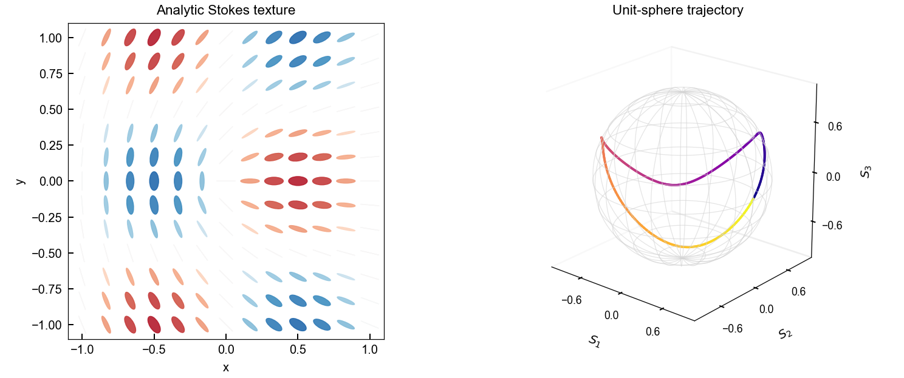

# Plot Foundation

[English](README.md) · [简体中文](README.zh-CN.md) · [实际生成的图集](docs/assets/showcase/gallery.html) · [公开 API](docs/public-api.md)

为科学数组提供类型化绘图规格、作用域样式与 Matplotlib 渲染器。在调用方坐标轴上绘制，再明确选择保存方式和位置。**版本 0.1.13 · Python 3.10+ · NumPy + Matplotlib。**



图片由公开渲染器从独立解析函数生成。[可运行源码](examples/synthetic_rendering.py) · [源码哈希、版本和检查](docs/assets/showcase/manifest.json)。它们展示软件功能，不是实验或仿真结果。

## 从数组到图形对象

| 数据／视图 | 公开组件 |
|---|---|
| 曲线与区间 | `LineSeries`、`RibbonSeries`、`ColorMappedLineSeries`、`LinePlotSpec` |
| 标量网格与等高线 | `HeatmapPlotSpec`、`HeatmapStyle`、`render_heatmap` |
| 多层曲面 | `SurfaceLayer`、`MultiSurfacePlotSpec`、`render_multi_surface_3d` |
| 向量与无头指向场 | `VectorFieldPlotSpec`、`render_vector_field` |
| 偏振 | `render_polarization_ellipses`、Poincare 散点／轨迹渲染 |
| 展示与导出 | `profile_context`、`SaveSpec`、`save_figure` |


未提供坐标轴时渲染器可创建画布，也可复用调用方坐标轴。渲染器不保存、不关闭画布、不创建目录。保存是独立步骤，要求父目录已存在。导入包不改变 Matplotlib 全局样式。领域语义、DataFrame、读取、manifest 和消费端工作流保留在库外。

## 安装与运行

下面的固定公开源码安装需要 Python 3.10+ 与 Git。也可安装核验过的本地 `plot_foundation-0.1.13-py3-none-any.whl`；不假定存在包索引发行。

```bash
python -m venv .venv
# 按当前 shell 的方法激活 .venv，然后执行：
python -m pip install "plot-foundation @ git+https://github.com/Patr1ck2005/plot-foundation.git@c3d3cc23b2bb4da7ade7e5edf553d4a36d19db7f"
python -m pip check
python examples/synthetic_rendering.py --out docs/assets/showcase
```

最后一条命令在本仓库运行，生成五组 PNG／SVG、离线 HTML 图集和来源 manifest。检查覆盖 x-first 方向、NaN 掩码、调用方坐标复用、曲面层数、Stokes 归一化及全局样式恢复。

## 完整渲染简例

```python
from pathlib import Path
from plot_foundation import (
    AxesSpec, LinePlotSpec, LineSeries, SeriesStyle,
    SaveSpec, profile_context, render_line_plot, save_figure,
)

Path("output").mkdir(exist_ok=True)  # 调用方负责目录。
spec = LinePlotSpec(
    series=(LineSeries([0, 1, 2], [0, 1, 0],
                       style=SeriesStyle(color="blue")),),
    axes=AxesSpec(xlabel="x", ylabel="Amplitude"),
)
with profile_context("publication_minimal"):
    result = render_line_plot(spec)
    save_figure(result.figure, "output/line.svg",
                SaveSpec(dpi=300, bbox_inches=None, transparent=True))
```

关闭画布也由调用方负责。最终放置应明确几何尺寸、标签和保存策略，不假定某个 profile 已决定全部物理展示选择。

## 网格与曲面合同



网格规格遵循 `values.shape == (len(x), len(y))`。渲染器将 x-first 数组转换为显示方向；消费端为 y-first 时，应在适配边界明确转置。示例使用 61 × 35 非方形网格，便于检测错误转向。

曲面是**二维标量网格**的一种视图，不代表稠密三维采样。多曲面分别保存高度、颜色、alpha 和 RGBA。NaN 保留缺失单元，不改变物理高度尺度，也不隐式生成网格文件。

| 独立曲面通道 | 偏振视图 |
|---|---|
|  |  |

[曲线／散点／区间／彩色线族](docs/assets/showcase/line-family.png) · [完整离线图集](docs/assets/showcase/gallery.html)。

## 样式规范与任务导航

| 任务 | 权威入口 |
|---|---|
| 科研图稿交付与完整文章图包 | [样式与 A4 交付规范](docs/style-policy.md#a4-paper-delivery) |
| 应用 profile、固定尺寸导出和消费端合同 | [样式实施与交付说明](docs/style-policy.md) |
| 先分类数据再选视图 | [Data Space and Visualization Views](https://github.com/Patr1ck2005/plot-workflows/blob/main/docs/data-space-and-visualization.md) |
| 使用渲染接口 | [公开 API](docs/public-api.md)、[曲线合同](docs/line-rendering-contract.md) |
| 开发与维护 | [架构](docs/architecture.md)、[Agent 规则](AGENTS.md)、[变更记录](CHANGELOG.md) |

Profile 区分展示方式：`diagnostic` 提供解释性标签／图例，保存预设为 150 DPI；`publication_minimal` 提供极简展示及透明紧裁的 300 DPI 预设；`preview` 是 150 DPI 的极简版本；`paper` 是 `publication_minimal` 的别名。`profile_context()` 限定样式作用域，实际导出由明确的 `SaveSpec` 控制。历史软件默认值、示例几何尺寸与现行图稿交付规范分别管理。

纵横比、范围、归一化和色图由调用方决定。图集明确采用固定画布 180 DPI 的文档预览，并记录实际导出尺寸。科学解释与课题约定留在消费端课题。

开发时在隔离环境安装 `.[dev]`，运行 `python -m pytest -q`。稳定消费端安装 wheel，不注入兄弟源码路径。[原概念图](docs/assets/portfolio/scientific-tools-research-v2.png)和[来源记录](docs/assets/portfolio/manifest.json)保留为辅助示意。采用 MIT 许可证。
